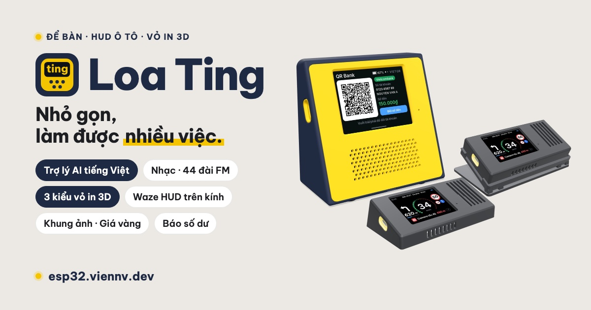

# Loa Ting

### Loa thông minh để bàn, vỏ in 3D

**Trợ lý AI tiếng Việt · Nhạc · 44 đài FM · Khung ảnh · Giá cả · Pomodoro · Waze HUD · Báo thức · Lịch âm · Báo biến động số dư**

---

**Loa Ting** là chiếc loa nhỏ có màn hình cảm ứng 2,8″, chạy trên mạch **LCDWIKI ES3C28P (ESP32-S3)**. Firmware dựa trên [Xiaozhi ESP32](https://github.com/78/xiaozhi-esp32), được viết lại giao diện tiếng Việt (có thêm tiếng Anh) và thêm nhạc, đài, khung ảnh, giá cả, Pomodoro, Waze HUD, báo thức, lịch âm và báo biến động số dư. Vỏ để bàn in 3D gồm 4 chi tiết, in một lần trên máy in nhiều màu. Thay vỏ HUD là đặt được lên ô tô, hình dẫn đường phản chiếu lên kính lái.

> Repo này chỉ chứa trang giới thiệu và các bản tải về. Mã nguồn để riêng tư.

## ▶️ Video giới thiệu

Video review gần 5 phút: vỏ in 3D, rồi từng ứng dụng trên loa. Xem tại **[esp32.viennv.dev](https://esp32.viennv.dev/#video)**.

## ✨ Tính năng

| | |
| --- | --- |
| 🤖 **Trợ lý AI “Hey Ivy”** | Gọi “Hey Ivy” rồi nói tiếng Việt tự nhiên: hỏi thời tiết, mở nhạc, mở đài, đặt báo thức, hẹn giờ. Chữ hiện ngay trên màn. |
| 🎵 **Nhạc theo yêu cầu** | Nói tên bài, loa tự tìm trên Zing MP3 hoặc YouTube rồi phát, có ảnh bìa và sóng nhạc. Dùng ngay với máy chủ nhạc cộng đồng, không phải tự cài. |
| 📻 **44 đài phát thanh** | VOV1 tới VOV5, VOV Giao thông, VOH, Đài Hà Nội và đài của hơn 20 tỉnh, kèm tần số. Gắn sao đài yêu thích, mở đài bằng giọng nói. |
| 🖼️ **Khung ảnh** | Lúc rảnh, loa chiếu ảnh từ album Google Photos bạn chọn, kèm giờ và thời tiết. |
| 🚗 **Waze HUD** | Đặt trên xe: hướng rẽ, làn đường, tốc độ, biển giới hạn và cảnh báo camera, nhận từ Waze Mod trên điện thoại qua Wi-Fi hoặc Bluetooth. |
| ⏰ **Báo thức, đếm ngược** | Đặt bằng tay hoặc bằng giọng nói, lặp theo thứ, 10 âm báo có sẵn. |
| 🍅 **Pomodoro** | 25 phút tập trung, 5 phút nghỉ, nghỉ dài sau 4 lượt; vẫn chạy khi đóng ứng dụng. |
| 💰 **Giá cả** | Giá vàng, xăng dầu và tỷ giá ngoại tệ, tự cập nhật mỗi giờ. |
| 🧮 **Máy tính, QR Wi-Fi** | Máy tính bỏ túi trên màn cảm ứng; mã QR cho khách quét là vào Wi-Fi. |
| 🌤️ **Đồng hồ, thời tiết, lịch âm** | Giờ to, chất lượng không khí, dự báo 4 ngày cho nơi bạn ở (loa tự biết theo mạng); lịch tháng có ngày âm, tiết khí, giờ tốt. |
| 🔋 **Pin trên mọi màn hình** | % pin ở góc mọi màn, xanh có tia sét khi sạc, đỏ khi dưới 20%; cắm sạc là hiện thẻ “Đang sạc”. |
| 🌙 **Ban đêm** | Màn hình tự dịu, chỉ còn đồng hồ to; thông báo được đọc thật nhỏ. |
| 💸 **Báo biến động số dư** | “Ting” rồi đọc số tiền vừa nhận, có mã VietQR và lịch sử giao dịch. |
| 📱 **Cài bằng điện thoại** | Quét mã trên loa để mở trang cài đặt. Không cần cài app. |

  
  
  

## 🧰 Phần cứng

- **Mạch LCDWIKI ES3C28P:** ESP32-S3, 16 MB flash, 8 MB PSRAM, Wi-Fi; màn IPS 2,8″ cảm ứng 320 × 240; codec ES8311, micro và loa đi kèm; khe microSD, đèn LED màu, USB-C sạc pin.
- **Vỏ để bàn:** 98,8 × 52 × 92 mm, mặt trước ngả 20°; pin 18650 dưới đáy, công tắc nguồn; mặt trước cài 4 nẫy móc, tì lên gờ đỡ 4 cạnh, không cần vít; loa dán băng keo 3M vào khuôn trong thân, cách lưới 5 mm; 7 khe thoát nhiệt sau lưng; viền cổng sạc in rời ôm sát cổng USB-C.
- **In 3D:** 5 chi tiết, khoảng 92 g nhựa, lưng xanh than hoặc đen, mặt trước vàng. File 3MF xếp sẵn bàn in 220 × 220.

📐 **[Trang Vỏ in 3D](https://esp32.viennv.dev/case/)**: so sánh 3 kiểu vỏ, thông số, cấu tạo, lý do thiết kế và mô hình 3D của từng vỏ.

🔌 **[Nạp firmware](https://esp32.viennv.dev/flash/)**: nạp ngay trên Chrome/Edge qua cáp USB, có từng bước và phần trăm.

📘 **[Tài liệu](https://esp32.viennv.dev/docs/)**: tự cài máy chủ nhạc và khung ảnh Google Photos, hoặc nối loa với nguồn báo biến động số dư (qua LAN hay máy chủ riêng, kèm máy chủ mẫu Python).

🧊 **[Xoay thử mô hình 3D](https://esp32.viennv.dev/3d/)** ngay trên trình duyệt: tách lớp, cắt dọc, giấu từng chi tiết.

### 🚗 Vỏ HUD cho ô tô

  
  

- **[Nghiêng 20°](https://esp32.viennv.dev/3d/hud-tilted/):** 127 × 69 × 35 mm, 3 chi tiết, khoảng 47 g; hợp kính lái 30–35°.
- **[Thân phẳng trên đế 5 nấc](https://esp32.viennv.dev/3d/hud-flat/):** thân 127 × 63 × 20 mm, chỉnh 10–40° cho mọi góc kính; 6 chi tiết, bản lề in liền, không chốt, không vít, khoảng 130 g.
- Cả hai: màu đen, loa của bộ mạch nằm cạnh màn để đọc cảnh báo, cổng USB-C bên trái hoặc phải có viền in rời, không pin (cắm nguồn xe), miếng thép trong đáy để hít giá nam châm. Nên in PETG hoặc ASA.
- File in vỏ HUD nghiêng (bản có loa) có trong bản phát hành; vỏ HUD phẳng: liên hệ trong nhóm Zalo.

## 📥 Tải về

- **Firmware 1.8.0:** nạp ngay trên trình duyệt ở trang [Nạp firmware](https://esp32.viennv.dev/flash/), hoặc tải các file `.bin` ở trang [Releases](https://github.com/esp32-project-tinggg/loa-ting-releases/releases/latest) để nạp bằng `esptool` (lệnh có trong ghi chú bản phát hành). Loa đã cài sẽ tự báo khi có bản mới, bấm Cập nhật mới cài.
- **File in vỏ** (3MF, STL, bản vẽ PDF): vỏ để bàn và vỏ HUD nghiêng (có loa) tải ở [trang Vỏ in 3D](https://esp32.viennv.dev/case/#tai-ve) hoặc trang Releases. Vỏ HUD phẳng: liên hệ trong [nhóm Zalo](https://zalo.me/g/cmx8rrljb8wxfl5uehfn).

## 🛠️ Tự làm một chiếc

1. **In vỏ, chuẩn bị:** in 5 chi tiết từ file 3MF. Cần thêm mạch ES3C28P (kèm loa), một pin 18650 và một công tắc nhỏ.
2. **Nạp firmware:** cắm mạch vào máy tính bằng USB-C rồi nạp ngay trên trình duyệt ở trang [Nạp firmware](https://esp32.viennv.dev/flash/), hoặc dùng `esptool` với các file ở trang [Releases](https://github.com/esp32-project-tinggg/loa-ting-releases/releases/latest). Cập nhật về sau vẫn giữ Wi-Fi và cài đặt.
3. **Cài bằng điện thoại:** vào Wi-Fi “Xiaozhi-xxxx” của loa để chọn mạng nhà, rồi quét mã trên loa để mở trang cài đặt.

## 💬 Nhóm Zalo

Hỏi đáp, khoe bản in, báo lỗi, góp ý tính năng trong nhóm **[Loa Ting - ESP32 Custom](https://zalo.me/g/cmx8rrljb8wxfl5uehfn)** trên Zalo. Trên máy tính, mở [esp32.viennv.dev](https://esp32.viennv.dev) và bấm nút “Hỏi đáp Zalo” ở góc phải dưới để quét mã QR bằng điện thoại.

---

Một dự án của **[viennv.dev](https://viennv.dev)** · Trang giới thiệu: **[esp32.viennv.dev](https://esp32.viennv.dev)**

Ảnh màn hình chụp từ giao diện thật, dữ liệu giao dịch là dữ liệu mẫu. Ảnh vỏ dựng từ mô hình 3D.

